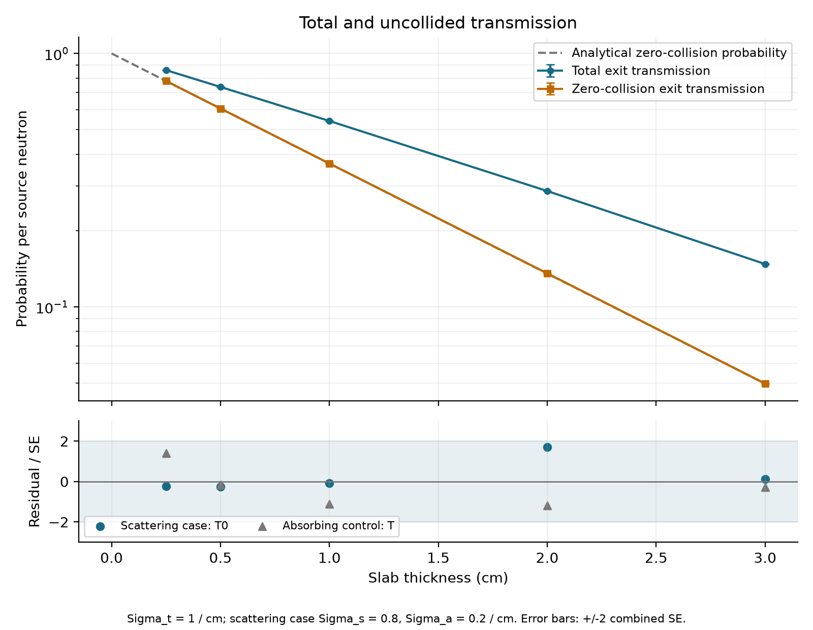
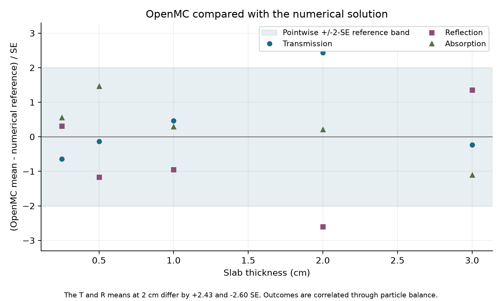
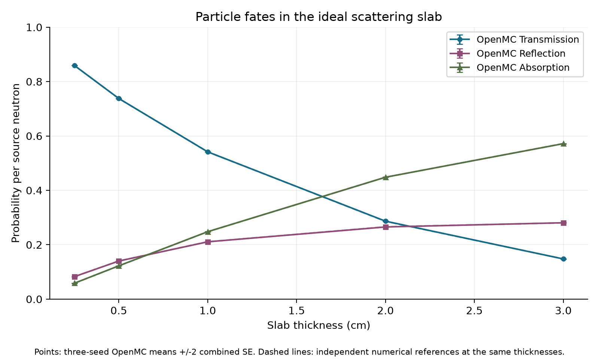

# Neutron transmission and scattering in OpenMC

Auhornish Adel | Stage 3 | November 2026

Production runs: 5 November UTC, or 4 November in Vancouver.

## Summary

This stage follows neutron histories through repeated collisions in a one-group OpenMC slab. A purely absorbing model is compared with an ideal scattering model at five thicknesses, with three runs of one million histories per thickness. Both models have a total cross section of 1 per cm. In the scattering model, 0.8 per cm is scattering and 0.2 per cm is absorption. At 3 cm, mean total transmission is 0.147643 and uncollided transmission is 0.049804. The original inputs and statepoints were checked, and a separate numerical transport solver provides a second comparison. Its largest difference from an OpenMC mean is 2.60 standard errors.

## 1. Why I went further

Stage 2 stopped following a neutron at its first collision. Here I wanted to see what happens afterwards. A scattered neutron can return through the entrance, be absorbed later, or still reach the exit. The question is how much those collided histories contribute to transmission as the slab gets thicker.

The comparison holds the total cross section fixed while changing the split between scattering and absorption. Adding a scattering contribution here means replacing some absorption. The coefficients are artificial constants rather than properties assigned to a real material.

| Parameter | Absorbing model | Scattering model |
|---|---|---|
| Total cross section, per cm | 1.0 | 1.0 |
| Scattering cross section, per cm | 0.0 | 0.8 |
| Absorption cross section, per cm | 1.0 | 0.2 |
| Thicknesses, cm | 0.25, 0.5, 1, 2, 3 | 0.25, 0.5, 1, 2, 3 |
| Runs per thickness | 3 | 3 |
| Histories per run | 1,000,000 | 1,000,000 |

The slab is infinite sideways. A point source in an upstream void emits along the slab normal, and the outer faces have vacuum boundaries. Its nominal energy is 1 MeV in one group spanning 0 to 20 MeV. Scattering is isotropic, and the material temperature is 294 K. The model has no fission and does not resolve energy loss. [1,2]

<!-- pagebreak -->

## 2. Total and uncollided transmission

For a uniform slab and a normally incident beam, `T0(L) = exp(-Sigma_t L)` is the probability of reaching the exit without a collision. In the absorbing model, this is also total transmission. In the scattering model, total transmission `T` also includes histories that collide and later reach the exit.



**Figure 1.** Three-run means with +/-2 combined standard-error bars. The lower panel compares uncollided transmission with the exponential reference in both models. Lines connecting sampled values are guides between the five tested thicknesses.

| Thickness (cm) | Total T +/- SE | Uncollided T0 +/- SE | Reflection R +/- SE | Absorption A +/- SE |
|---|---|---|---|---|
| 0.25 | 0.859323 +/- 0.000198 | 0.778749 +/- 0.000236 | 0.082447 +/- 0.000164 | 0.058230 +/- 0.000139 |
| 0.5 | 0.737748 +/- 0.000261 | 0.606456 +/- 0.000278 | 0.139895 +/- 0.000206 | 0.122357 +/- 0.000188 |
| 1 | 0.541538 +/- 0.000298 | 0.367860 +/- 0.000279 | 0.210633 +/- 0.000225 | 0.247829 +/- 0.000254 |
| 2 | 0.286568 +/- 0.000254 | 0.135668 +/- 0.000196 | 0.265258 +/- 0.000261 | 0.448174 +/- 0.000295 |
| 3 | 0.147643 +/- 0.000207 | 0.049804 +/- 0.000131 | 0.280706 +/- 0.000268 | 0.571651 +/- 0.000285 |

**Table 1.** Scattering-model means and standard errors per source neutron. At 1 cm, mean T is 0.541538 and mean T0 is 0.367860. At 3 cm, about 66.3% of the transmitted component has collided. This is a ratio of means; its uncertainty was not calculated from the correlated component tallies.

<!-- pagebreak -->

## 3. Checking the results

All 30 production statepoints were checked against their saved inputs and cross sections. The checks covered seeds, histories, source and file hashes, and tally filters. Means and standard errors were recalculated from the HDF5 sums and squared sums. The largest scattering-run departure of `T + R + A` from one was 2.22e-16. Balance checks the accounting, but a balanced result can still have a transport error.



**Figure 2.** Differences between the OpenMC means and a separate numerical solution, divided by the combined standard error. At 2 cm, transmission differs by +2.43 SE and reflection by -2.60 SE. All points are included. The three outcomes are correlated through particle balance, so these are not 15 independent tests.

The numerical solver treats the uncollided beam analytically and solves for the collided flux using step characteristics and discrete angular directions. It integrates a constant source within each spatial cell and couples the directions through the scalar flux. Checks covered the absorbing limit, optical-depth scaling, weak-scattering first-collision integrals, positivity, and conservation. The solver is a separate implementation, with the refinement results below. [3]

| Thickness (cm) | Last spatial change | Last angular change |
|---|---|---|
| 0.25 | 1.20e-08 | 1.67e-13 |
| 0.5 | 6.70e-08 | 2.30e-13 |
| 1 | 3.26e-07 | 6.71e-14 |
| 2 | 1.21e-06 | 9.05e-14 |
| 3 | 2.04e-06 | 4.71e-14 |

**Table 2.** Largest change in T, R, or A from 256 to 512 spatial cells at 128 positive directions, then from 128 to 256 positive directions at 512 cells. The final solution has 512 total angular directions. The largest spatial change, 2.04e-6, is small relative to the Monte Carlo standard errors. These refinement changes are diagnostics rather than rigorous error bounds.

<!-- pagebreak -->

## 4. Where the histories end



**Figure 3.** Transmission, reflection, and absorption in the scattering slab. Points are three-run OpenMC means with +/-2 combined standard errors. Dashed lines connect the numerical references at the same thicknesses.

From 0.25 to 3 cm, total transmission falls from 0.859323 to 0.147643. Reflection rises from 0.082447 to 0.280706, and absorption rises from 0.058230 to 0.571651. The fraction of transmitted histories that have collided rises from about 9.4% to 66.3%.

The absolute scattered-transmission contribution is largest at 1 cm among the five tested thicknesses. Finding a maximum over all thicknesses would need a more detailed sweep.

The main difference from Stage 2 is the distinction between leaving the original beam and being absorbed. Some collided histories still reach the exit. The exponential remains useful, but it describes the uncollided component rather than the full transmitted fraction.

## 5. Limits of the study

The cross sections are one-group constants. The study does not test energy-dependent material data, anisotropic scattering, thermal scattering laws, or finite sideways leakage. Temperature effects were not varied. Three seeds per thickness give limited information about between-run variation, and only one scattering ratio was tested.

There is no experimental or reactor-criticality comparison. A future real-material study would need specified composition, density, temperature, and a traceable nuclear-data library.

## 6. What this stage adds

The absorbing model checks the exponential limit. The scattering model then separates transmitted, reflected, and absorbed histories, with a second transport method for comparison. Together, the saved runs show how the first-collision model changes when collided neutrons are followed to their final outcome.

<!-- pagebreak -->

## 7. Reproducing the calculation

The production runs used OpenMC 0.16.0, commit `617d35a5063c57796b43428bc401e627d2011046`, in the official container below. Every case used 100 batches of 10,000 histories and two OpenMP threads. Absorbing seeds were 2026110401 through 2026110415; scattering seeds were 2026110501 through 2026110515. Earlier setup runs and the single scattering pilot are saved separately from these production averages.

`openmc/openmc@sha256:d3dd6b6629db3d2cfd04b238959a264b2f0e274b5a6f828b443e05b18b9f2b27`

For independent runs with means `Y_i` and batch standard errors `u_i`, the reported mean is their arithmetic mean. Its standard error is `sqrt(sum(u_i^2)) / r`, with `r = 3`. Each tally error is recalculated as `sqrt((sum_sq/n - mean^2)/(n-1))` from the saved batch sums. Here, `n` is the number of batches, `mean` is the average batch score, and `sum_sq` is the sum of squared batch scores. Error bars are pointwise. One of the fifteen scattering-run uncollided residuals exceeds two standard errors; none exceeds three. The maximum is 2.303.

## Numerical reference

The uncollided scalar flux is `phi0(x) = exp(-Sigma_t x)`. The collided angular flux obeys:

```text
mu * d(psi_c)/dx + Sigma_t * psi_c = q(x)
q(x) = (Sigma_s/2) * [phi0(x) + phi_c(x)]
```

The incoming collided flux is zero at each vacuum boundary. For constant source q in a cell:

```text
a = exp(-tau),  b = (1-a)/tau,  tau = Sigma_t*dx/abs(mu)
psi_out = a*psi_in + (q/Sigma_t)*(1-a)
psi_average = b*psi_in + (q/Sigma_t)*(1-b)
```

The collided scalar flux is `phi_c(x) = integral(psi_c(x, mu) dmu, -1, 1)`, and the total scalar flux is `phi = phi0 + phi_c`. Symmetric Gauss-Legendre integration over positive and negative directions gives the cell-averaged scattering operator. A direct linear solve couples the cell scalar fluxes. Boundary currents give T and R; absorption is `Sigma_a * integral(phi dx)`. The first-collision source uses the exact cell average of the uncollided beam.

The repository's `reproduce_study.py` checks the original statepoints and rebuilds the numerical comparison, figures, and report. It does not rerun the OpenMC histories.

## References

[1] Romano, P. K., et al. (2015). [OpenMC: A State-of-the-Art Monte Carlo Code for Research and Development](https://doi.org/10.1016/j.anucene.2014.07.048). Annals of Nuclear Energy, 82, 90-97.

[2] OpenMC Development Team. [Tallies](https://docs.openmc.org/en/stable/usersguide/tallies.html); [multigroup cross sections](https://docs.openmc.org/en/stable/pythonapi/generated/openmc.XSdata.html); [fixed-source settings](https://docs.openmc.org/en/stable/usersguide/settings.html).

[3] Lahdour, M., et al. (2019). [The discrete ordinate method for angular flux calculations in slab geometry](https://doi.org/10.1016/j.heliyon.2019.e02211). Heliyon, 5(8), e02211. Background on angular discretization. The present solver uses the step-characteristics equations above, a different implementation from the article's matrix method.

## Assistance

I ran the OpenMC campaigns. AI tools helped with code, data checks, the numerical comparison, figures, and writing.
